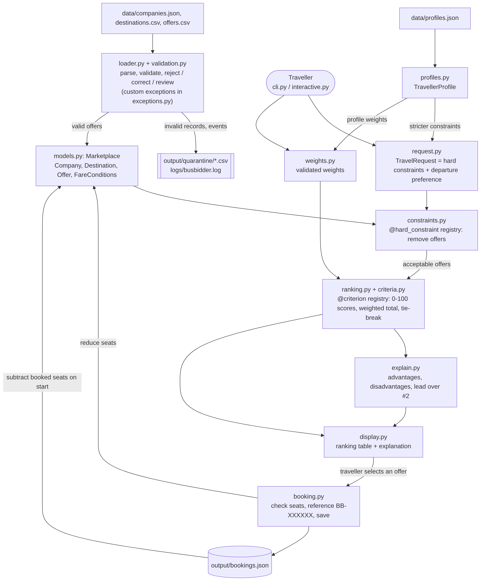

# BusBidder Spain

A modular Python application that filters and ranks competing bus offers from
Madrid for an individual traveller, explains the recommendation and makes a
simulated booking. Final project for ACIT4420 Problem-solving with scripting.



## Requirements

* Python 3.10 or newer (developed and tested with Python 3.15, also tested on 3.10 and 3.13)
* No third-party libraries. Only the standard library is used, so
  `requirements.txt` lists no packages and nothing needs to be installed.

## Quick start

Run every command from the project root (the folder containing this README).

Guided mode, which asks one question at a time:

```
python3 -m busbidder
```

The example request from the specification (Madrid to Malaga, 12-14 July,
maximum EUR 50, morning, at most 1 transfer, changeable ticket):

```
python3 -m busbidder search --to Malaga --from 2027-07-12 --until 2027-07-14 --budget 50 --depart morning --max-transfers 1 --changeable
```

Run the tests:

```
python3 -m unittest discover -v
```

Reproduce every output used in the report (written to `examples/`):

```
python3 -m busbidder.experiments
```

## All commands

| Command | What it does |
|---|---|
| `python3 -m busbidder` | guided search, ranking, explanation and booking |
| `python3 -m busbidder validate -v` | load the data and list every rejected, corrected and review record |
| `python3 -m busbidder search --to CITY --from DATE [options]` | filter, rank and explain offers |
| `python3 -m busbidder search ... --profile business --book` | use a traveller profile, then choose an offer to book |
| `python3 -m busbidder compare --to CITY --from DATE --until DATE` | run the same trip for every traveller profile |
| `python3 -m busbidder book OFFER_ID --name "NAME" [--passengers N]` | book an offer directly |
| `python3 -m busbidder bookings [REFERENCE]` | list bookings or show one |
| `python3 -m busbidder cancel REFERENCE` | cancel a booking with a simulated refund |
| `python3 -m busbidder.data_generator --seed 42` | regenerate the dataset (already included) |
| `python3 -m busbidder.experiments` | regenerate the report evidence in `examples/` |

`python3 -m busbidder search --help` lists every search option. Hard
constraints: `--to`, `--from`, `--until`, `--budget`, `--max-transfers`,
`--changeable`, `--refundable`, `--bags`, `--max-hours`, `--passengers`. Soft
preferences: `--depart` (early, morning, afternoon, evening, night or
HH:MM-HH:MM), `--weights` (for example
`price=30,duration=20,departure=10,flexibility=20,emissions=20`) or `--profile`.

Offers exist for travel dates 2027-07-10 to 2027-07-16.

## Project layout

```
busbidder/              application package
  __main__.py           entry point for python3 -m busbidder
  cli.py                command-line commands
  interactive.py        guided question-by-question mode
  config.py             file locations and constants
  exceptions.py         custom exception hierarchy
  models.py             Company, Destination, FareConditions, Offer, Marketplace
  validation.py         field parsers, regex identifiers, offer validator
  loader.py             reads the files, applies the reject/correct/review policy
  logging_setup.py      log file configuration
  request.py            travel request and departure time windows
  constraints.py        hard constraints (registry decorator) and the filter
  criteria.py           scoring criteria (registry decorator) and normalisation
  weights.py            weight parsing and validation
  ranking.py            weighted ranking, tie-breaking, criterion influence
  explain.py            generated explanation of a recommendation
  profiles.py           traveller profiles and profile comparison
  booking.py            simulated booking, references, cancellation
  display.py            text tables for the CLI
  data_generator.py     seeded generator for the simulated dataset
  experiments.py        reproducible experiments for the report
data/                   input data (generated with seed 42)
  companies.json        5 companies
  destinations.csv      15 destinations with distance from Madrid
  offers.csv            1,575 offer rows including 20 deliberately faulty ones
  injected_faults.json  the faulty rows and their expected outcome
  profiles.json         traveller profiles
docs/                   architecture diagram, report figures and the script that draws them
examples/               saved outputs that the report refers to
tests/                  unit tests (unittest, 190 tests)
logs/                   log file (created at run time, not committed)
output/                 quarantine files and bookings.json (created at run time, not committed)
```

## Data and validation

The dataset is simulated and generated with a fixed seed, so it is identical
on every machine. All 75 company-destination combinations are present for
10-16 July 2027, with one or two departures a day and two fare classes per
departure.

| Outcome | When | Where it goes |
|---|---|---|
| Rejected | impossible or unusable values (negative price, unknown destination or company, invalid date, arrival before departure, rating outside 1-5, negative seats, malformed or duplicate id, id that does not match the record) | `output/quarantine/rejected_offers.csv` |
| Corrected | intended value is unambiguous (comma decimal, letter case, duration that disagrees with the times) | kept, correction logged |
| Review | possible but implausible (average speed above 110 km/h, price above EUR 250) | `output/quarantine/review_offers.csv` |

Offers with zero seats are valid (sold out) and are removed by the seat
constraint. Missing ratings and emissions are allowed. Every event is written
to `logs/busbidder.log`.

## Hard constraints and soft preferences

| Hard constraints (offer removed) | Soft preferences (affect the score) |
|---|---|
| destination, travel window, seats for all passengers, maximum ticket price, maximum transfers, changeable ticket, refundable ticket, minimum checked bags, maximum journey time | preferred departure window, criterion weights |

## Scoring

Each criterion is converted to a 0-100 score, then combined with the weights:
`total = sum(weight x score)`.

| Criterion | Scale |
|---|---|
| price, duration, emissions | relative to the other acceptable offers (best = 100), with outlier fences (1.5 x IQR) and a minimum range (EUR 5, 30 min, 2 kg) |
| departure | 100 inside the preferred window, falling to 0 at 4 hours outside |
| flexibility | 60% change policy (none 0, fee 50, free 100) + 40% refund policy (none 0, partial 50, full 100) |
| transfers (optional) | 0 -> 100, 1 -> 60, 2 -> 25, 3 -> 0 |
| rating (optional) | 1.0 -> 0, 5.0 -> 100, missing -> 50 |

Missing emissions score 0. Default weights: price 40%, duration 25%,
departure 15%, flexibility 20%. Weights must total 1.0 (or 100) and the four
core criteria must each have a weight. A single weight above 50% gives a
warning. Ties are broken by price, duration, departure time and offer id.

## Traveller profiles

Defined in `data/profiles.json`. A profile can only make the base trip
stricter (the stricter value wins when both set the same constraint).

| Profile | Weights | Departure | Extra hard constraints |
|---|---|---|---|
| budget | price 55, duration 15, departure 10, flexibility 10, transfers 10 | none | none |
| business | price 10, duration 35, departure 25, flexibility 20, transfers 10 | 06:00-09:00 | changeable, direct |
| flexible | price 20, duration 10, departure 10, flexibility 45, rating 15 | 10:00-14:00 | at least 1 checked bag |
| eco | price 20, duration 15, departure 10, flexibility 10, emissions 45 | morning | none |

## Booking

Seats in `offers.csv` are never changed. Confirmed bookings are stored in
`output/bookings.json` and subtracted from the seat counts every time the
program starts, so capacity stays consistent between runs. References have
the form `BB-XXXXXX` (no 0/O or 1/I). No payment information is collected.
Cancelling releases the seats and computes a simulated refund from the
stored fare conditions (full 100%, partial 50%, none 0%).

## Example outputs

| File | Content |
|---|---|
| `examples/01_validation.txt` | every rejected, corrected and review record |
| `examples/02_example_search.txt` | the specification's example request |
| `examples/03_profiles_MAL.txt`, `_BAR`, `_SAL` | four profiles on three routes |
| `examples/04_weight_sweep.txt` / `.csv` | winner as the price weight goes from 10% to 70% |
| `examples/05_normalisation.txt` | effect of outlier fences and minimum range |
| `examples/06_missing_emissions.txt` | missing CO2 scored as worst versus neutral |
| `examples/07_company_wins.txt` / `.csv` | which companies win across all routes and profiles |
| `examples/08_rank_reversal.txt` | removing one offer changes the order of the others |

The report figures in `docs/figures/` are drawn from these files with
`python3 docs/make_figures.py`. That script is the only part of the project
that needs a third-party library (`pip install matplotlib`).

## Declarations

### Declaration of generative AI use

I used AI tools, mainly Claude (Anthropic) and ChatGPT (OpenAI), as support during parts of the project. They assisted with designing the application, writing parts of the code, creating and formatting figures and tables, formatting the report and improving the language of the text. The central question, the scope and assumptions, the simulated dataset, the design of the experiments, the analysis, the interpretation of the results and the final decisions were carried out by me. I reviewed and critically assessed all AI-assisted suggestions and code, tested the code and checked that the content, figures and references remained accurate before including them in the final report.
